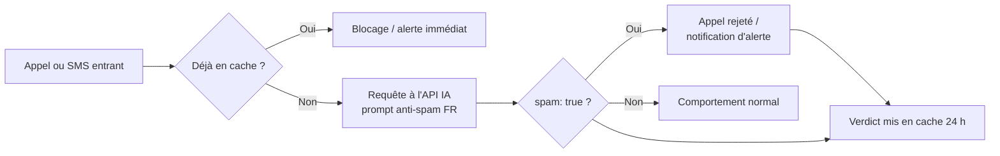

# SpamGuard 🛡️

Application Android open source qui filtre les **appels** et analyse les **SMS** entrants
avec une **IA**, via n'importe quelle API compatible OpenAI (Mistral AI, OpenRouter, Ollama, ...).

  <em>Appels rejetés avant même de sonner, SMS suspects signalés avec explication.</em>

## ✨ Fonctionnalités

- **Filtrage d'appels** : un appel jugé spam est rejeté avant même de faire sonner le téléphone.
- **Analyse de SMS** : chaque SMS reçu est analysé ; s'il est suspect, une notification
  "SMS suspecté spam" s'affiche avec le texte et l'explication de l'IA.
- **N'importe quelle API LLM** compatible avec le format OpenAI `chat/completions`
  (par défaut : [Mistral AI](https://console.mistral.ai)).
- **Cache de verdicts 24 h** : un numéro déjà jugé n'est pas re-soumis à l'IA.
- **Fail-open** : en cas d'erreur réseau ou d'IA trop lente, l'appel est laissé passer.
- **Zéro tracking** : la clé API reste sur l'appareil, aucune donnée collectée.

## 📱 Installation directe (sans Android Studio)

Le dépôt compile l'APK automatiquement à chaque push, via GitHub Actions :

1. Onglet **Actions** du dépôt → dernier run **Build APK** → tout en bas, section **Artifacts**
2. Télécharge **SpamGuard-debug-APK** (un zip) et dézippe-le : l'APK est dedans
3. Sur le téléphone : autorise l'installation depuis des sources inconnues, puis installe l'APK
4. Ouvre SpamGuard, colle ta clé API, active le filtrage

## 🚀 Installation (développeur)

1. Installe [Android Studio](https://developer.android.com/studio).
2. Clone ce dépôt : `File > New > Project from Version Control`.
3. Laisse Android Studio télécharger Gradle et les dépendances au premier `Sync`.
   (Si Studio se plaint d'un wrapper Gradle manquant : `gradle wrapper --gradle-version 8.7`.)
4. Branche ton téléphone en USB (débogage activé) puis `Run` ▶️.

## ⚙️ Configuration

1. Crée une clé API sur [console.mistral.ai](https://console.mistral.ai) (ou ton fournisseur préféré).
2. Ouvre SpamGuard et colle la clé dans **Clé API**.
3. Ajuste si besoin l'**URL** (`https://api.mistral.ai/v1`) et le **modèle** (`mistral-small-latest`).
4. Appuie sur **Activer le filtrage d'appels** et accepte le rôle dans la boîte de dialogue Android.
5. Utilise la **zone de test** pour vérifier que l'IA répond correctement.

## ⚠️ Limitations honnêtes

- **SMS non supprimables** : Android ne permet pas à une app tierce d'effacer un SMS ou
  d'empêcher sa notification (réservé à l'app SMS par défaut). SpamGuard **alerte**, il ne bloque pas.
- **Latence des appels** : Android attend peu de temps, l'IA doit répondre en ~4,5 s.
  Un modèle rapide (`mistral-small-latest`) est recommandé.
- **Rôle de filtrage** : sans le rôle "Screening d'appels" accordé, les appels ne sont pas filtrés.
- **Coût API** : chaque appel/SMS inconnu = une requête API. Le cache limite la facture.

## 🧭 Idées pour la suite (contributions bienvenues !)

- [ ] Historique des verdicts (numéro, verdict, raison)
- [ ] Bouton "signaler / corriger le verdict" pour affiner le prompt
- [ ] Whitelist/blacklist manuelle en plus de l'IA
- [ ] Filtre on-device (hors-ligne) en secours de l'API
- [ ] Réponse vocale IA aux appels inconnus (via serveur SIP/VoIP)
- [ ] Interface bilingue FR/EN

## 🏗️ Architecture en bref

| Fichier | Rôle |
|---|---|
| `MainActivity.kt` | Écran de configuration + zone de test |
| `SpamCallScreeningService.kt` | Demandé par Android à chaque appel : bloquer ou laisser ? |
| `SmsReceiver.kt` | Prévenu à chaque SMS : analyse + notification |
| `LlmClient.kt` | Construit la requête, appelle l'API, parse le verdict JSON |
| `VerdictCache.kt` | Cache mémoire des verdicts (24 h) |
| `Settings.kt` | Sauvegarde des préférences (clé API, modèle, toggles) |

## 📄 Licence

[MIT](LICENSE) — fais-en ce que tu veux, incl. citation des auteurs originaux.
