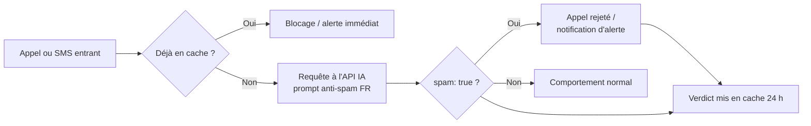

# SpamGuard 🛡️

Application Android open source qui filtre les **appels** et analyse les **SMS** entrants
avec une **IA**, via n'importe quelle API compatible OpenAI (Mistral AI, OpenRouter, Ollama, ...).

  <em>Appels rejetés avant même de sonner, SMS suspects signalés avec explication.</em>

## ✨ Fonctionnalités

**Filtrage d'appels en 3 couches** (du plus rapide au plus lent, l'IA n'est consultée qu'en dernier recours) :

1. **Couche 0, instantanée** : liste blanche et liste noire de l'utilisateur,
   et **préfixes ARCEP réservés au démarchage** (0162, 0163, 0270, 0271, 0377, 0378,
   0424, 0425, 0568, 0569, 0948, 0949 — décision ARCEP n° 2022-1583 : un démarcheur
   est obligé d'appeler depuis ces préfixes). Rejet ou autorisation en ~0 ms, sans réseau.
2. **Couche 1, offline** : base de **756 879 organismes français légitimes**
   (hôpitaux, écoles, mairies, gendarmeries — source [WinCalls](https://wincalls.fr/opendata.html),
   licence ODbL) : reconnus et laissés tranquilles sans consulter l'IA ;
   tes **contacts** ne sont jamais filtrés non plus.
3. **Couche 2, IA** : tout le reste, via n'importe quelle API compatible
   OpenAI `chat/completions` (par défaut [Mistral AI](https://console.mistral.ai)).

**Mémorisation à vie** : quand l'IA juge un numéro spam, il rejoint automatiquement
la liste noire permanente. La première fois, il attend l'IA ; jamais plus ensuite.

- **Analyse de SMS** : même pipeline en couches ; notification avec l'explication.
- **Journal & numéros** : historique de chaque analyse (verdict, raison, couche
  décisionnaire), gestion des listes, et bouton **Signaler au 33700**
  (plateforme officielle française de signalement des spams téléphoniques).
- **Cache de verdicts 24 h** + **base 100 % autonome** : premier téléchargement
  automatique dès qu'un Wi-Fi est disponible, rafraîchissement hebdomadaire et
  dès que la base a plus de 6 jours (WorkManager, Wi-Fi uniquement).
- **Fail-open** : en cas d'erreur réseau ou d'IA trop lente, l'appel est laissé passer.
- **Zéro tracking** : la clé API reste sur l'appareil, aucune donnée collectée.

## 📱 Installation directe (sans Android Studio)

Le dépôt compile l'APK automatiquement à chaque push, via GitHub Actions :

1. Onglet **Actions** du dépôt → dernier run **Build APK** → tout en bas, section **Artifacts**
2. Télécharge **SpamGuard-debug-APK** (un zip) et dézippe-le : l'APK est dedans
3. Sur le téléphone : autorise l'installation depuis des sources inconnues, puis installe l'APK
4. Ouvre SpamGuard, colle ta clé API, active le filtrage

## 🚀 Installation (développeur)

1. Installe [Android Studio](https://developer.android.com/studio).
2. Clone ce dépôt : `File > New > Project from Version Control`.
3. Laisse Android Studio télécharger Gradle et les dépendances au premier `Sync`.
   (Si Studio se plaint d'un wrapper Gradle manquant : `gradle wrapper --gradle-version 8.7`.)
4. Branche ton téléphone en USB (débogage activé) puis `Run` ▶️.

## ⚙️ Configuration

1. Crée une clé API sur [console.mistral.ai](https://console.mistral.ai) (ou ton fournisseur préféré).
2. Ouvre SpamGuard et colle la clé dans **Clé API**.
3. Ajuste si besoin l'**URL** (`https://api.mistral.ai/v1`) et le **modèle** (`mistral-small-latest`).
4. Appuie sur **Activer le filtrage d'appels** et accepte le rôle dans la boîte de dialogue Android.
5. Utilise la **zone de test** pour vérifier que l'IA répond correctement.

## ⚠️ Limitations honnêtes

- **SMS non supprimables** : Android ne permet pas à une app tierce d'effacer un SMS ou
  d'empêcher sa notification (réservé à l'app SMS par défaut). SpamGuard **alerte**, il ne bloque pas.
- **Latence des appels** : Android attend peu de temps, l'IA doit répondre en ~4,5 s.
  Un modèle rapide (`mistral-small-latest`) est recommandé.
- **Rôle de filtrage** : sans le rôle "Screening d'appels" accordé, les appels ne sont pas filtrés.
- **Coût API** : chaque appel/SMS inconnu = une requête API. Le cache limite la facture.

## 🧭 Idées pour la suite (contributions bienvenues !)

- [x] ~~Historique des verdicts (numéro, verdict, raison)~~ ✅ v0.2 (écran Journal)
- [x] ~~Whitelist/blacklist manuelle en plus de l'IA~~ ✅ v0.2
- [x] ~~Filtre on-device (hors-ligne) en secours de l'API~~ ✅ v0.2 (ARCEP + base organismes)
- [ ] Bouton "signaler / corriger le verdict" pour affiner le prompt
- [ ] Import de listes de numéros spam communautaires
- [ ] Réponse vocale IA aux appels inconnus (via serveur SIP/VoIP)
- [ ] Interface bilingue FR/EN

## 🏗️ Architecture en bref

| Fichier | Rôle |
|---|---|
| `MainActivity.kt` | Écran de configuration, base offline, zone de test |
| `JournalActivity.kt` | Journal des analyses, listes noire/blanche, signalement 33700 |
| `SpamCallScreeningService.kt` | Le pipeline en 3 couches, appelé par Android à chaque appel |
| `SmsReceiver.kt` | Prévenu à chaque SMS : même pipeline, analyse + notification |
| `PhoneBook.kt` | Normalisation des numéros + détection des préfixes ARCEP du démarchage |
| `SpamList.kt` | Listes noire et blanche persistantes |
| `WincallsDb.kt` | Téléchargement et consultation de la base offline des organismes |
| `DbUpdateWorker.kt` | Mise à jour hebdomadaire de la base (WorkManager) |
| `LlmClient.kt` | Construit la requête, appelle l'API, parse le verdict JSON |
| `VerdictCache.kt` | Cache mémoire des verdicts (24 h) |
| `VerdictLog.kt` | Journal des événements (100 derniers) |
| `Settings.kt` | Sauvegarde des préférences (clé API, modèle, toggles) |

## 📚 Sources et licences

- Base des organismes : [WinCalls Open Data](https://wincalls.fr/opendata.html), licence
  [ODbL 1.0](https://opendatacommons.org/licenses/odbl/1-0/) (attribution requise, incluse dans l'app).
- Préfixes du démarchage : décision ARCEP n° 2022-1583.
- Signalement officiel : [33700](https://www.33700.fr).

## 📄 Licence

[MIT](LICENSE) — fais-en ce que tu veux, incl. citation des auteurs originaux.
